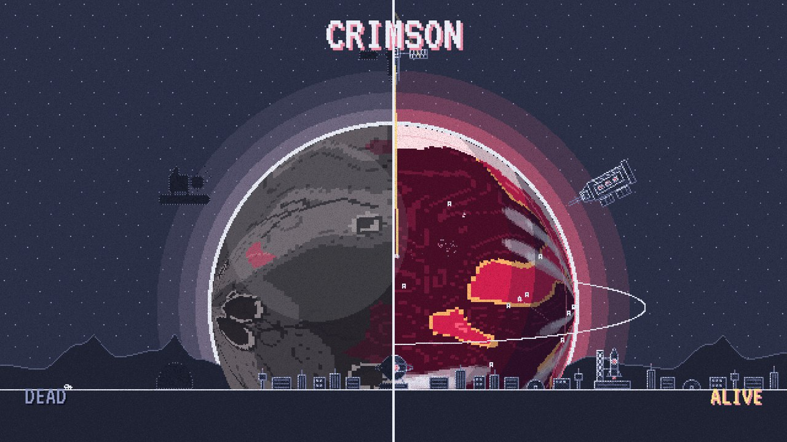

# Terraform

A pixel-art idle game: heal dead alien worlds with lasers, mirrors, drones, comets, antimatter and more, with real space-science facts along the way. Progress keeps counting while the game is closed. Winner, CodeDay Fall 2026 (Bengaluru).

**Play:** https://utkarshbahuguna.me/terraform-idle/ · **itch.io:** https://utkarshbahuguna.itch.io/terraform · **Trailer:** https://youtu.be/UW-W3ORA4IU

## How it plays

- Tap the planet for Life, spend it on six systems per world, upgrade them and watch the surface turn from rock to oceans and forests. A moon, clouds and rings arrive at 25%, 50% and 75%.
- Eight worlds, each with its own palette, a trait that changes the economy (orbital or ground systems, taps, goal rewards) and a different set of systems. Every healed world doubles all output for good, hands you a Star Seed for the 20-talent tree, and the goal grows x4, so later worlds are faster but never trivial. Each warp offers three boons (a head start, x3 taps, a shorter goal, more events...) for the next world. After the eighth, a short cinematic shows all eight worlds alive with your best times, and the cycle restarts.
- Every few minutes at the screen something happens: a meteor shower (taps x5), a solar flare (every system fires double) or a golden comet to catch for a minute of income.
- Systems refit as they level: Lv 10, 25 and 50 on any upgrade turn them Mark II, III and IV (cyan, gold, then white with a halo), on the planet and in the bar.
- Tap combos: keep tapping within 0.6 s and taps pay x1.25 from 10 in a row, x1.5 from 25.
- Commander Vos chimes in when things happen (events, refits, big catches, long absences, speed records).
- The healed planet comes alive: lightning in the clouds, gulls circling, an aurora at 100%. Each world has its own soundtrack tempo and key.
- Vos also hands out optional timed contracts (unlock the next system in 3 minutes, chain a 15-tap combo...) that pay a few minutes of income.
- Photo mode (P, or Settings): a clean picture of your planet with a caption, shared or downloaded.
- A daily supply drop parachutes in once per calendar day. There is also something to find if you tap the moon.
- 22 achievements, listed in the settings sheet; a run timer with your best time per world; a Share button on the warp screen; haptics on phones.
- Income runs on the wall clock: up to 12 hours (24 with Night Shift) are paid when you come back.
- Keyboard: Enter/Space taps (or catches a comet or crate when one is up), M taps the moon, P takes a photo, `1`–`6` open a system, Esc closes or skips. Screen readers get the HUD, panels and the commander's lines.
- Settings (gear in the Life box): music, sound, reduced motion (also follows the system setting), large text, save code export/import, new game. Saves live in the browser only; the code is how you move one between devices.

Installable as a web app and playable offline (manifest + service worker). No dependencies, no build step, no backend: `index.html`, `style.css`, `data.js` (every number and line of text: systems, prices, worlds, goals, briefing), `game.js` (the engine).

Run it locally: serve the folder with any static server, e.g. `python3 -m http.server`, then visit http://localhost:8000. Add `?reset` to the URL to start over.

License: MIT (see LICENSE). The VT323 font is by Peter Hull under the SIL Open Font License (fonts/OFL.txt).

## Trailer

`trailer/` makes the trailer with [trailer-kit](https://github.com/IFAKA/trailer-kit): `driver.mjs` plays a scripted tour of the game, `music.mjs` synthesizes the soundtrack on the beat plan in `src/plan.mjs`, and `src/Trailer.tsx` is the Remotion edit (16:9 and 9:16).
